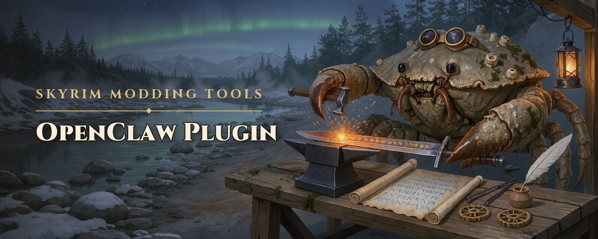
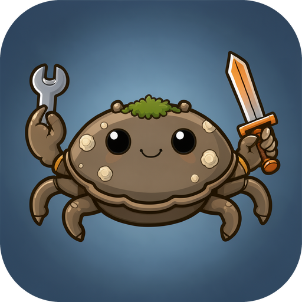

<p align="center">
  
</p>

<p align="center">
  <a href="https://github.com/Ciltress/skyrim-modding-tools-openclaw-plugin/actions/workflows/ci.yml"></a>
  <a href="LICENSE"></a>
  
  
</p>

# skyrim-modding-tools-openclaw-plugin

**Mod Skyrim Special Edition with your OpenClaw agents** — even with a small model running on your own PC. Ask an
agent for a flaming sword, a dragon shout, a chest in Breezehome or one outdoors in Riverwood, a quest that starts with
the game, a patch, a mod from Nexus or the reason for your last crash: this plugin gives it the tools to look into your
whole load order, write mods as text projects, build them into plugins and deploy them into Mod Organizer or Amethyst,
install mods, read crash logs, and arrange a cell in Blender and bring it back.

The tools are [skyrim-modding-tools-core](https://github.com/Ciltress/skyrim-modding-tools-core)'s; the
[MCP server](https://github.com/Ciltress/skyrim-modding-tools-mcp) serves the same tools to any MCP client.

## Why a plugin

It does what an MCP server cannot in OpenClaw:

- **Tools under their own names** — `editRecord`, not `skyrim__editRecord` — kept outside Tool Search, so a
  small local model sees them without searching.
- **The instructions** the MCP server announces, which OpenClaw drops, in the system prompt of the agents that mod.
- **The skills** ship with the plugin; no `skills.load.extraDirs`.
- **A build check:** an agent that changed a project and did not build it is asked once more before it answers.
  OpenClaw makes that pass only in a run whose calls it could replay — its own read-only tools — so after a plugin
  tool's call or a write it logs the request instead; the tools' own answers say to build next as well.
- **A write guard:** an agent's write or edit of a record file that would land in the projects folder outside every
  project's plugin folder, where no build reads it, goes to the file's path in its project instead, and the answer
  names that path. Where the project or the group folder cannot be told, it is stopped, with where the file goes. A
  write over a record file a build numbered keeps the FormKey line the build gave it, where the content leaves it out.
- **A text-call check:** an answer that wrote a tool call as text, which runs nothing, is asked to make the call — one
  in a call tag (`<tool_call>`, `<call>`, `<tool_code>`) wherever it is; one of the agent's tools written with its
  arguments (`readSkill{…}`, `openclaw_tool_call{id: "readSkill", …}`, `{"tool_name": "readSkill", …}`) where the
  answer ends on it, asked for only if it was meant to run. OpenClaw makes this pass as the build check's, only in a run
  of its replay-safe tools.
- **An announced-step check:** in a run that made no call yet, an answer that ends saying what it is about to do
  ("First, I am reading the basics skill.", "Let me check …" — not "Let me know …") and does nothing is asked to take
  that step, if it was meant to be taken now.

## How well it works

`npm run eval` has an OpenClaw agent do 35 tasks on a test instance and checks what it made against the game: looking
records up and patching them, 14 kinds of mod — a sword, an armor, a potion, a recipe, an arrow, a dragon shout, a
magic effect, a leveled list, a chest placed in Breezehome, a perk, a quest with its script, a spell, an NPC and a
note — each asked plainly and in detail, five times each, and two crash logs read: 155 runs a round. In its latest
round gemma4:e4b, a small model run locally by Ollama, passed 144 of 155. It runs on an Ollama build with the gemma4
tool-call repairs of [ollama/ollama#19274](https://github.com/ollama/ollama/pull/19274). A chest placed outdoors, and with
`--blender` a cell arranged through Blender's MCP server, are tasks of the next rounds.

## Modding with Muddy! 🦀



Meet **Muddy**, the modding agent: a mudcrab from the shore below Riverwood who learned to mod Skyrim. Cheerful,
proud of his shell, exact at the workbench, and made for this plugin's tools. After the [install](#install), one
command sets up the plugin and Muddy:

```bash
openclaw skyrim setup
```

The wizard looks like OpenClaw's own setup and asks for:

1. **Your Mod Organizer instance:** one it finds, or a folder you paste. Please use a test instance. With Amethyst on
   Linux, there is nothing to ask.
2. **A Nexus Mods API key:** only for downloading with a premium account. Enter skips it.
3. **Muddy:** his **model** (one OpenClaw lists, or one Ollama has installed), his **context** (32k is enough for one
   mod at a time; more needs more memory), how long he **thinks**, and whether he may **learn** from his work by
   writing skills of his own (`skill_workshop`).

He gets his own workspace, `~/.openclaw/workspace-muddy`, with his soul, his identity and his avatar. The projects
folder is his working folder, and he has the modding skills and the tools he needs: this plugin's, the file tools, the
web and his memory — and where OpenClaw has [Blender's MCP server](https://www.blender.org/lab/mcp-server/), its tools, to
arrange a cell `exportCell` put into Blender himself (Blender needs the PyNifly add-on). Run the wizard again to change
any of it: it updates the Muddy it finds and keeps what you added.

For a script or an agent setting it up for you, `--yes` asks nothing:
`openclaw skyrim setup --yes --instance "<folder>" --model ollama/<model>`, with `--context`, `--thinking`,
`--no-learn` and `--no-muddy` besides.

## Install

### From ClawHub

Needs OpenClaw 2026.10.7 or later and the .NET 10 runtime for the plugin helper: on Windows its installer from
[dotnet.microsoft.com](https://dotnet.microsoft.com/download/dotnet/10.0), on Linux your distribution's package
(`dotnet-runtime` on Arch and CachyOS). Windows and Linux on x64 only.

```bash
openclaw plugins install clawhub:skyrim-modding-tools
openclaw skyrim setup
```

The package brings the core and its helper, built. The second line is the [wizard](#modding-with-muddy-), which sets
up the plugin and Muddy. OpenClaw runs nothing of a plugin after installing it, so until an agent mods with the tools,
the gateway's log reminds you of it.

### From source

Needs OpenClaw 2026.10.7 or later (on Node.js 24.22.1) and the .NET 10 SDK for the plugin helper.

```bash
git clone https://github.com/Ciltress/skyrim-modding-tools-openclaw-plugin
cd skyrim-modding-tools-openclaw-plugin
npm install
npm run build
npm run build:helper
openclaw plugins install -l .
openclaw skyrim setup
```

### Settings

The wizard sets what most need. Everything else, or all of it by hand, is in OpenClaw's Settings page — *Plugins →
Skyrim Modding Tools*: the Mod Organizer instance (or
Amethyst), the projects folder, the agents that mod, a premium account's Nexus Mods API key if you want to download
through Nexus (searching it needs none) — or in
`~/.openclaw/openclaw.json`:

```json5
{
  plugins: {
    entries: {
      "skyrim-modding-tools": {
        enabled: true,
        // The instructions and the build check are conversation hooks.
        hooks: { allowConversationAccess: true },
        config: {
          mo2Instance: "G:/Modding/SkyrimSE-Test",
          projectsDir: "C:/Users/you/skyrim-projects",
          nexusApiKey: "<your key>",
          // The agents that mod.
          agents: ["skyrim"]
        }
      }
    }
  },
  agents: {
    entries: {
      skyrim: {
        cwd: "C:/Users/you/skyrim-projects",
        tools: { allow: ["read", "write", "edit", "skills_read", "skyrim-modding-tools"] }
      }
    }
  }
}
```

The tools are optional: an agent gets them only when its `tools.allow` names the plugin (or a tool). Every field
is listed in Settings with what it does; the rarer ones — the Creation Kit and Papyrus compiler, Amethyst's folder,
a Wine prefix, the tool profile — are under *advanced*. Settings shows the Nexus key hidden, and it may be a
SecretRef. A path may start with `~`; a relative one is the plugin's folder's. Without `projectsDir` the projects
are in `skyrim-modding-tools/projects` in OpenClaw's state folder (`~/.openclaw`, or the profile's), which an update
of the plugin leaves alone.

## Development

```bash
npm install            # links the installed OpenClaw for its SDK's types
npm run build          # tsc -> dist/, and the core's skills into skills/
npm test
npm run manifest       # after a tool changed in the core: rewrite openclaw.plugin.json
npm run build:helper   # the core's helper, in node_modules/skyrim-modding-tools-core
openclaw plugins reload skyrim-modding-tools --accept-capabilities
npm run eval -- --openclaw-agent <agent> --runs 1 --authoring-runs 5 --detailed   # a round of the eval, on a test instance
```

`--blender` adds the task that arranges a cell through Blender's MCP server, which the agent then needs in OpenClaw.

See [AGENTS.md](AGENTS.md).

### Releasing on ClawHub

ClawHub installs a package with `npm install --ignore-scripts`, so the package carries the core, bundled, with its
helper built for both systems: `npm run stage:clawhub` lays it out in `stage/` and packs it into `out/`. The
*ClawHub release* workflow (Actions tab, run by hand) builds `SkyrimHelper.exe` on Windows, packs on Linux, where
the Linux launcher keeps its executable bit, and hands the package to ClawHub's publish workflow: a preview while
*dry_run* is ticked.

The first release is published by hand, which creates the package on ClawHub: run the workflow as a preview,
download its `clawhub-package` artifact, then

```bash
npx clawhub login
npx clawhub package publish ./skyrim-modding-tools-<version>.tgz
npx clawhub package trusted-publisher set skyrim-modding-tools \
  --repository Ciltress/skyrim-modding-tools-openclaw-plugin --workflow-filename clawhub-release.yml
```

From then on: raise `version` in package.json, push, and run the workflow with *dry_run* unticked.
`npx clawhub package moderation-status skyrim-modding-tools` shows the review of the latest release.

## License

GPL-3.0-only, as the core. The ClawHub package also ships the helper's libraries, each under its own license:
[THIRD_PARTY_NOTICES.md](THIRD_PARTY_NOTICES.md).
